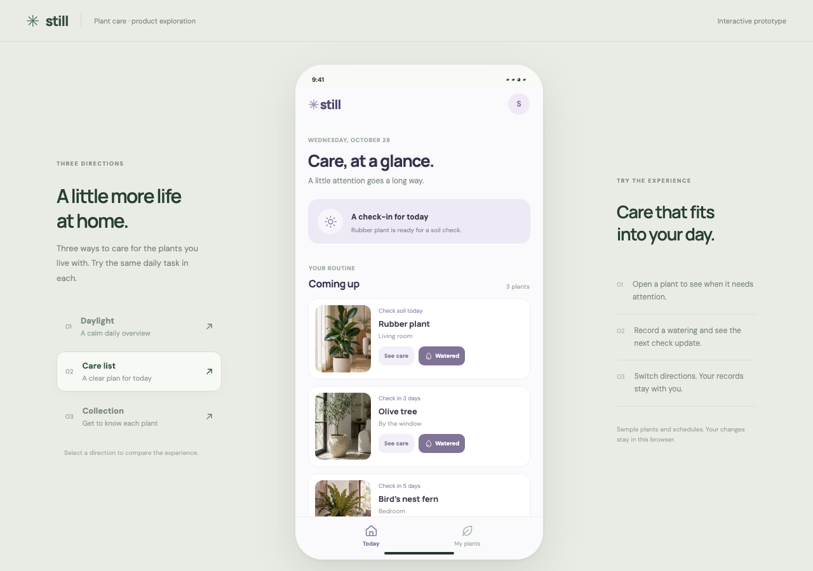
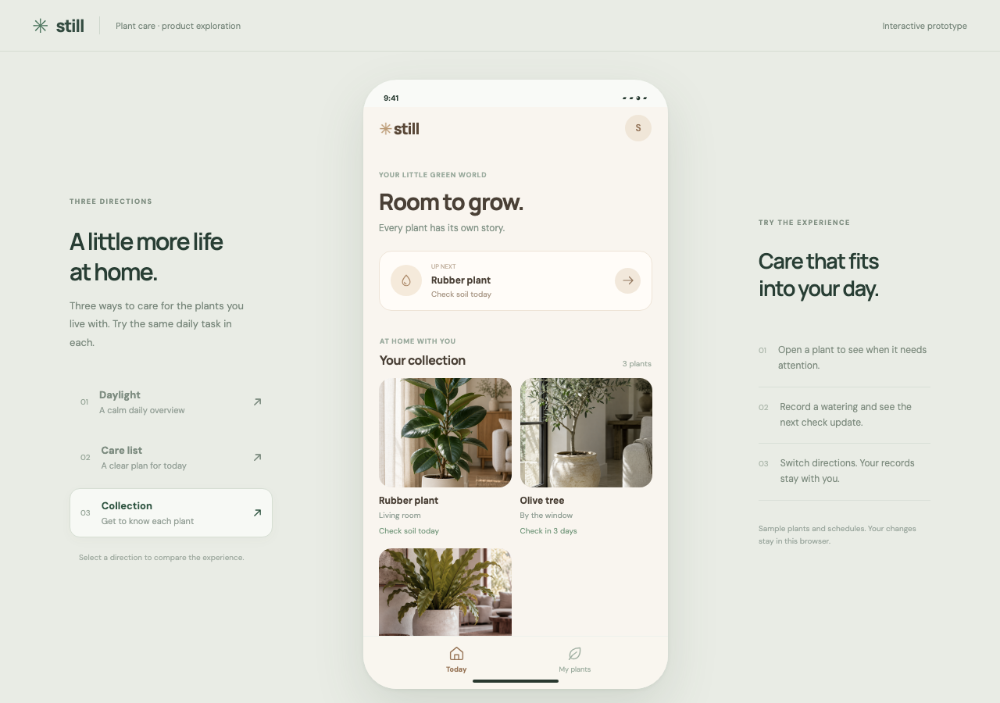

# Product Prototype

Turn a product idea into an interactive web prototype that you can explore, compare, and refine with an AI coding agent.

Product Prototype is an [Agent Skill](https://agentskills.io/). Give it a product idea for a mobile app, desktop app, or web app. It guides the agent to create three distinct design directions by default, connect the key interactions, and open a local preview for review.

[中文说明](README.zh-CN.md)

## Example: a plant-care app

The agent built three directions for the same task: view a plant, record watering, and see when it needs attention. These screenshots show one local evaluation; they are examples, not a guarantee of a particular visual style.


| Care list | Collection |
| --- | --- |
|  |  |

## Example: a desktop photography workspace

The same skill also guided a desktop-app prototype for planning shoots and tracking gallery delivery.


These are screenshots of prototype demos, not production applications. Their data and unconnected services are simulated. The example apps are not included in this repository.

## Install

The skill needs an AI coding agent with local file and command access. A browser-capable tool helps the agent inspect and test its work. The agent selects a suitable frontend stack and dependencies for the task.

### Codex

Clone the repository into your personal Codex skills directory:

```sh
mkdir -p ~/.agents/skills
git clone https://github.com/joevilcai666/product-prototype.git ~/.agents/skills/product-prototype
```

Start a new Codex session and invoke `$product-prototype` in your request. Codex may also select the skill automatically when it fits the task. See [Codex skill locations](https://developers.openai.com/codex/skills).

### Claude Code

```sh
mkdir -p ~/.claude/skills
git clone https://github.com/joevilcai666/product-prototype.git ~/.claude/skills/product-prototype
```

Start a new Claude Code session and invoke `/product-prototype`. The skill uses a portable `SKILL.md` format; a full end-to-end Claude Code run has not yet been verified. See [Claude Code skills](https://code.claude.com/docs/en/skills).

These commands expect the destination not to exist. If you already have a skill with this name, review it before installing.

## Try it

```text
$product-prototype Design a mobile app that helps me care for my plants.
Let me view plants, record watering, and see what needs attention next.
```

For Claude Code, replace `$product-prototype` with `/product-prototype`. You can also supply product requirements, audience, existing brand guidelines, or references. The agent asks about missing decisions that materially affect the core experience and makes reasonable assumptions about routine details.

The first review normally includes three runnable directions for the same core journey. Each should have real UI state and feedback, a suitable device or window preview, and clear boundaries for simulated behavior. Select a direction or combine specific ideas, then ask the agent to refine it.

## What to expect

- A local web prototype, not a deployed product or native application.
- Interaction and visual checks where the environment provides the necessary tools; the agent should report limits it cannot verify.
- Example data or simulated services when real services are not connected.
- Results that depend on the brief, the agent, available tools, and iteration. Exact native-system behavior and visual fidelity are not guaranteed.

## License

[MIT](LICENSE). Example screenshots are included to illustrate the skill's output; the sample product names and designs are for demonstration.
