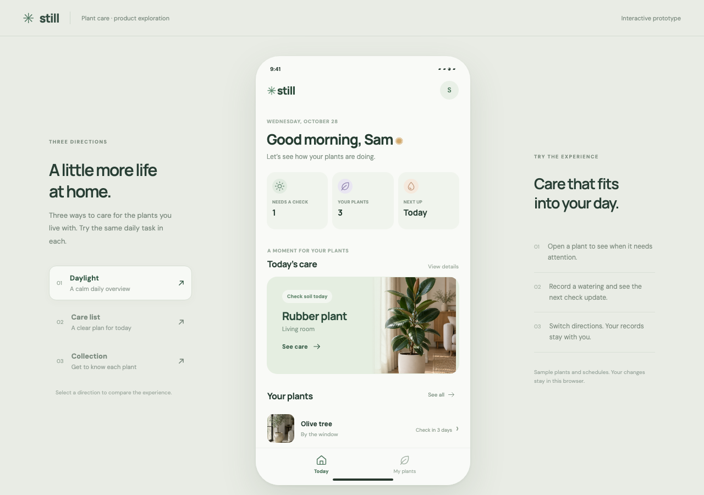
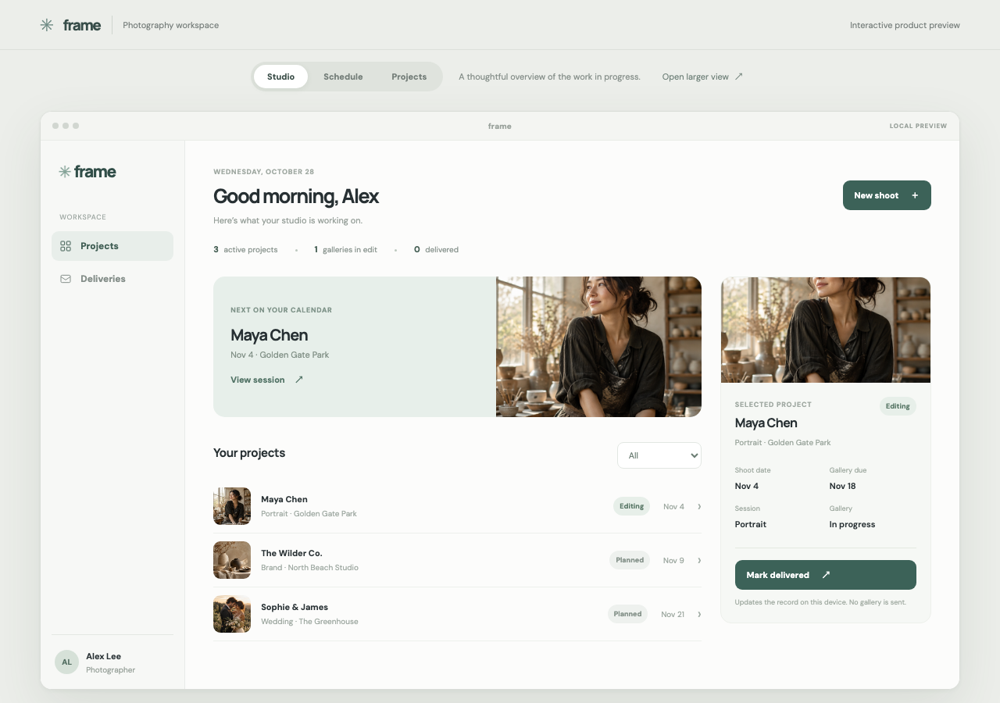

# Product Prototype

用一段产品想法，生成可以操作、比较和继续完善的网页原型。

Product Prototype 是一个 [Agent Skill](https://agentskills.io/)。你可以描述手机 App、桌面 App 或网页产品。Skill 会指导编程 Agent 默认制作三个不同的设计方向，连接关键交互，并提供本地预览。

[English](README.md)

## 原型示例

植物养护 App 的三个方向围绕同一任务：查看植物、记录浇水和了解下一次关注时间。



同一个 Skill 也用于制作摄影师桌面工作台原型：



这些图片来自本地测试，产品数据和未接入的服务均为示例。仓库不包含示例应用的源码。图片展示一种可能的结果，不保证每次生成都使用相同风格。

## 安装

你需要一个能够访问本地文件和运行命令的 AI 编程 Agent。浏览器工具可以帮助 Agent 检查和测试页面。

### Codex

```sh
mkdir -p ~/.agents/skills
git clone https://github.com/joevilcai666/product-prototype.git ~/.agents/skills/product-prototype
```

打开新的 Codex 会话，在需求中调用 `$product-prototype`。也可参考 [Codex 的 Skill 位置说明](https://developers.openai.com/codex/skills)。

### Claude Code

```sh
mkdir -p ~/.claude/skills
git clone https://github.com/joevilcai666/product-prototype.git ~/.claude/skills/product-prototype
```

打开新的 Claude Code 会话，调用 `/product-prototype`。Skill 使用可移植的 `SKILL.md` 格式，但尚未完成 Claude Code 端到端实测。可参考 [Claude Code Skills 文档](https://code.claude.com/docs/en/skills)。

以上命令要求目标目录不存在。如果已有同名 Skill，请先检查，避免覆盖。

## 使用示例

```text
$product-prototype 设计一个帮助我照顾植物的手机 App。
让我可以查看植物、记录浇水，并知道下一次需要关注什么。
```

在 Claude Code 中，把 `$product-prototype` 换成 `/product-prototype`。你也可以提供目标用户、产品需求、品牌规范或参考资料。缺少会影响核心体验的决策时，Agent 会提问；常规细节由 Agent 自行判断。

默认首次交付三种可运行方向，覆盖同一条关键流程。选定方向后，你可以继续提出修改，或要求结合其他方向的具体优点。

## 使用边界

输出是本地网页原型，不代表原生 App、真实服务或部署已经完成。未接入的服务可以模拟，并应明确标注。最终效果取决于需求、Agent、可用工具和迭代；不能保证完全复现原生系统行为或特定视觉效果。

## 许可证

[MIT](LICENSE)。示例截图仅用于展示 Skill 的输出，示例产品名称和设计用于演示。
